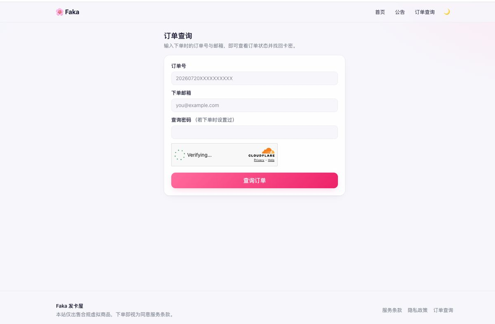
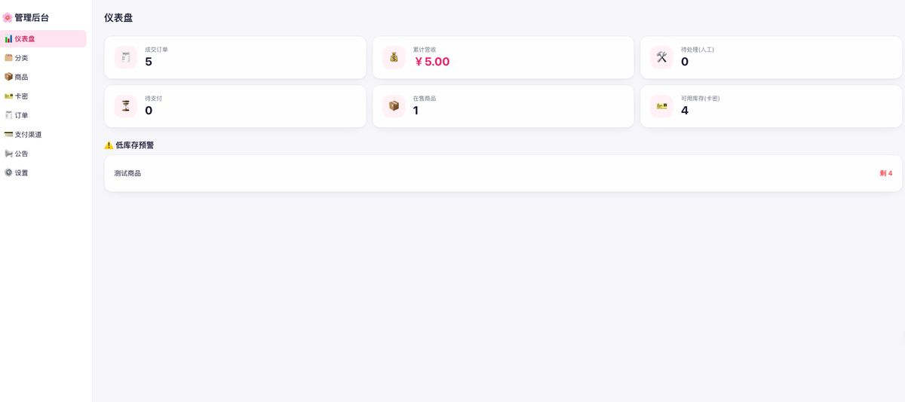
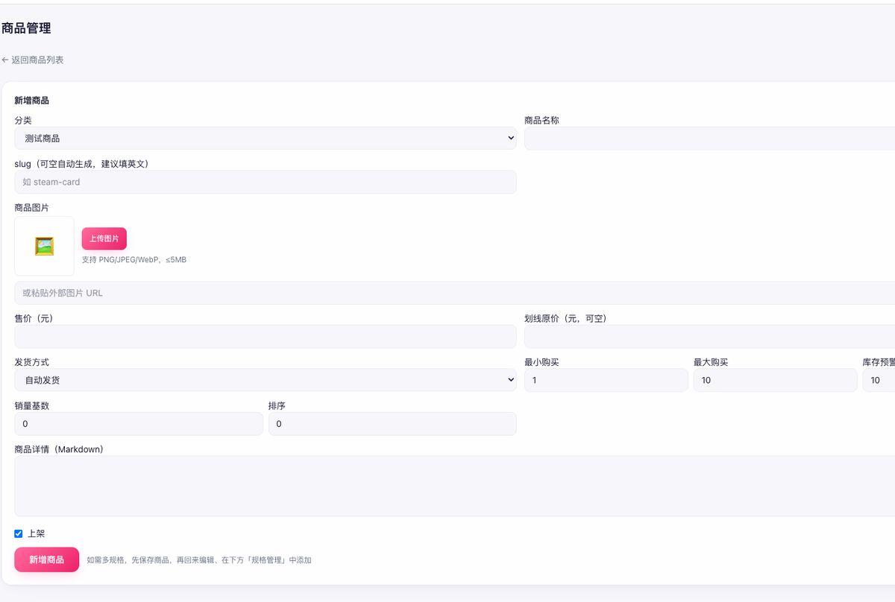
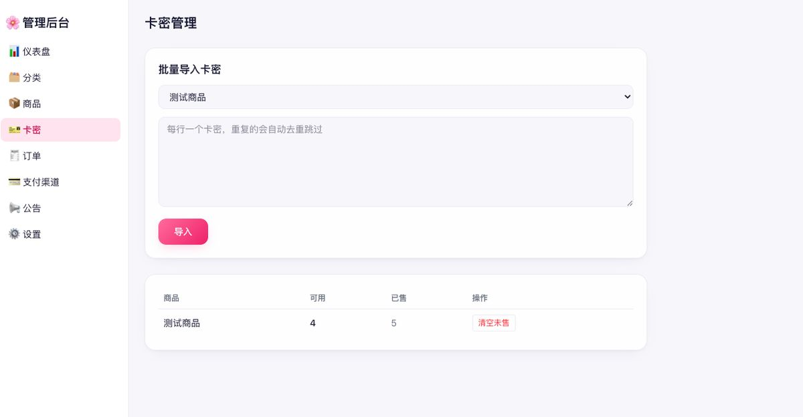
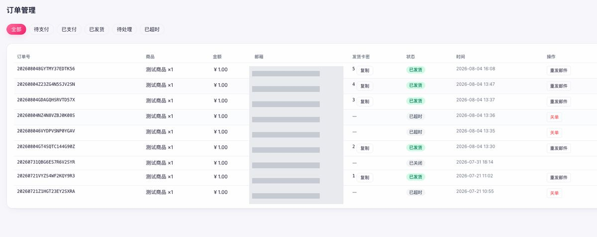
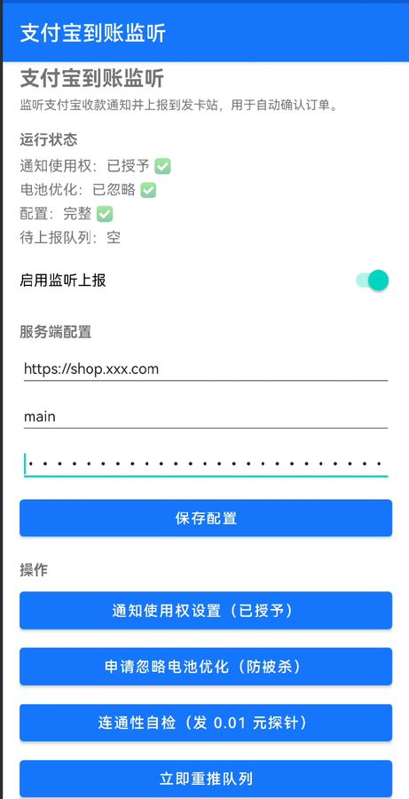

# 发卡网 Fakawang

跑在 **Cloudflare Workers** 上的虚拟商品自动发卡站。买家付款后**自动秒发卡密**，卖家零运维——没有服务器、没有数据库实例要管，小站每月成本可以是 **0 元**。

[](https://deploy.workers.cloudflare.com/?url=https://github.com/certhon/fakawang)

🔗 **在线预览**：<https://shop.muyear.com> —— 用本项目搭建的站点，可浏览前台实际效果。

支持支付宝（**个人收款码** / 当面付 / 易支付）、USDT（TRC20 · Polygon · Arbitrum）、Binance Pay。

```
买家下单 → 支付 → 自动对账 → 秒发卡密 → 邮件送达
```


---

## 目录

- [先看这个：它适合你吗](#先看这个它适合你吗)
- [功能](#功能)
- [一键部署（推荐）](#一键部署推荐)
- [手动部署](#手动部署)
- [本地开发](#本地开发)
- [配置详解](#配置详解)
- [支付渠道](#支付渠道)
- [支付宝个人码收款](#支付宝个人码收款)
- [常见问题](#常见问题)
- [核心机制](#核心机制)
- [目录结构](#目录结构)
- [安全须知](#安全须知)

---

## 先看这个：它适合你吗

**适合**

- 卖虚拟商品（会员账号、激活码、软件授权、教程），需要 7×24 自动发货
- 不想租服务器、不想配 Nginx / MySQL / 备份
- 想收 USDT，或者只有个人收款码、没有商户号

**不适合**

- 需要实物物流、发票、复杂售后流程
- 需要高度定制的多商户平台

**成本**：Cloudflare 免费档就能跑起来；正式收款建议开 Workers 付费档（$5/月）。域名另算（约 ¥70/年，也可以直接用免费的 `*.workers.dev`）。

---

## 功能

**买家侧**

- 商品浏览、分类、多规格（月卡/季卡/年卡）、批发阶梯价
- 下单支付，**付款后自动发货**，卡密即时展示并发送到邮箱
- 凭「订单号 + 邮箱」随时查单取货，可另设查询密码
- 站内公告、服务条款

| 商品页与收银台 | 订单查询取货 |
|---|---|
|  |  |

**卖家后台** `/admin`

| 模块 | 能力 |
|---|---|
| 仪表盘 | 销售额、订单数、库存预警 |
| 商品 | 分类、多规格、阶梯价、上下架、自动/人工发货 |
| 卡密 | 批量导入、库存统计、**加密存储**、按规格分库 |
| 订单 | 全状态查询、查看完整邮箱、已发货订单可复制卡密 |
| 支付渠道 | 逐个启用配置，密钥走 Secrets 不落库 |
| 公告 / 设置 | 站点文案、USDT 汇率、订单超时、维护模式 |

| 仪表盘 | 商品管理 |
|---|---|
|  |  |
| **卡密批量导入** | **订单管理**（截图中邮箱已打码） |
|  |  |

后台已适配手机，出门在外也能查单补货。

> 优惠券的数据表与下单抵扣字段已就位，但**后台管理页尚未实现**，目前需直接操作数据库。欢迎 PR。

**自动化**

- 每分钟轮询链上到账、关闭超时订单
- 整点检查低库存并邮件告警
- 发货邮件通过 Resend 发送

---

## 一键部署（推荐）

点上面的 **Deploy to Cloudflare** 按钮，Cloudflare 会：

1. 把本仓库 fork 到你的 GitHub
2. **自动创建** D1 数据库、KV 命名空间、R2 存储桶，并回填配置
3. 构建并部署到你的 Workers

部署完成后，**还有 3 步必须手动做**，否则站点不可用：

### 1. 初始化数据库

Cloudflare 会创建空数据库，但不会自动建表：

```bash
git clone https://github.com/<你的用户名>/fakawang.git
cd fakawang && npm install
npx wrangler login

npm run db:migrate:remote   # 建表
npm run db:seed:remote      # 可选：灌入演示商品，熟悉后可在后台删掉
```

### 2. 配置必需的密钥

```bash
npx wrangler secret put CARD_ENC_KEY      # 卡密加密主密钥
npx wrangler secret put SESSION_SECRET    # 后台会话签名
npx wrangler secret put CRON_SECRET       # 保护定时任务接口
npx wrangler secret put TURNSTILE_SECRET  # 人机验证
```

> 每个都用强随机值：`openssl rand -hex 32`
>
> ⚠️ **`CARD_ENC_KEY` 丢失后所有卡密永久无法解密，务必离线备份。**

### 3. 设置站点地址并重新部署

`NEXT_PUBLIC_SITE_URL` 是**构建期**注入的，必须改完重新部署：

```bash
# 编辑 .env.production，把 NEXT_PUBLIC_SITE_URL 改成你的实际地址
# 例如 https://fakawang.你的子域.workers.dev
npm run deploy
```

### 完成后

打开 `https://你的地址/admin` —— **首次登录输入的账号密码会自动注册为管理员**，请立刻设强密码。

---

## 手动部署

不想用按钮，或者想完全掌控每一步：

```bash
git clone https://github.com/certhon/fakawang.git
cd fakawang
npm install
npx wrangler login
```

**1. 创建资源**

```bash
npx wrangler d1 create fakawang-db             # 记下返回的 database_id
npx wrangler kv namespace create FAKA_KV       # 记下返回的 id
npx wrangler r2 bucket create fakawang-assets  # 可选，用于商品图
```

**2. 填进 `wrangler.jsonc`**

```jsonc
"d1_databases": [{ "binding": "DB", "database_name": "fakawang-db",
                   "database_id": "刚才返回的 id", "migrations_dir": "drizzle" }],
"kv_namespaces": [{ "binding": "FAKA_KV", "id": "刚才返回的 id" }],
```

**3. 建表 + 配密钥 + 部署**

```bash
npm run db:migrate:remote

npx wrangler secret put CARD_ENC_KEY
npx wrangler secret put SESSION_SECRET
npx wrangler secret put CRON_SECRET
npx wrangler secret put TURNSTILE_SECRET

# 改 .env.production 里的 NEXT_PUBLIC_SITE_URL
npm run deploy
```

---

## 本地开发

> 需要 Node.js 20+（推荐 22）。**不需要**任何真实支付账号。

```bash
npm install
cp .dev.vars.example .dev.vars   # 本地密钥，已 gitignore

npm run db:migrate:local         # 建本地表
npm run db:seed:local            # 灌演示数据
npm run dev                      # http://localhost:3000
```

开箱即用的两个便利：

- 内置 **Turnstile 测试密钥**，人机验证自动通过
- 内置 **Mock 支付渠道**，点一下「模拟支付成功」就能走完 下单 → 对账 → 发货 → 邮件 全链路

想在真实 Workers 运行时里联调支付回调：`npm run preview`（workerd 本地运行）。

---

## 配置详解

### 三类配置的区别（这里最容易搞混）

| 类型 | 放哪 | 什么时候生效 | 举例 |
|---|---|---|---|
| **公开变量** | `.env.production` | **构建期**注入，改完必须重新部署 | `NEXT_PUBLIC_SITE_URL`<br>`NEXT_PUBLIC_TURNSTILE_SITE_KEY` |
| **密钥** | `wrangler secret put` | 运行时读取，改完即时生效 | `CARD_ENC_KEY`、各渠道密钥 |
| **业务配置** | 后台页面（存数据库） | 即时生效 | 站点名称、USDT 汇率、收款地址 |

> 最常见的坑：改了 `NEXT_PUBLIC_SITE_URL` 却没重新部署，导致支付回调仍指向旧地址。

### 密钥清单

| 名称 | 必需 | 用途 |
|---|---|---|
| `CARD_ENC_KEY` | ✅ | 卡密 AES-256-GCM 加密。**丢失 = 卡密全废** |
| `SESSION_SECRET` | ✅ | 后台会话签名 |
| `CRON_SECRET` | ✅ | 保护定时任务接口 |
| `TURNSTILE_SECRET` | ✅ | 人机验证服务端校验 |
| `RESEND_API_KEY` | | 发货邮件（不配则不发信） |
| `MAIL_FROM` | | 发件人地址 |
| `ALIPAY_PUSH_SECRET` | | 支付宝个人码上报签名 |
| `EPAY_KEY` | | 易支付 |
| `ALIPAY_PRIVATE_KEY` `ALIPAY_PUBLIC_KEY` | | 支付宝当面付 |
| `BINANCE_API_KEY` `BINANCE_SECRET` | | Binance Pay |
| `TRONGRID_API_KEY` | | USDT TRON 链查账 |
| `ETHERSCAN_API_KEY` | | USDT Polygon / Arbitrum 查账 |

完整说明见 [`.dev.vars.example`](./.dev.vars.example)。

### 配置人机验证（正式收款前必做）

不配的话默认用测试密钥，**等于没有防护，会被脚本刷单**。

1. Cloudflare 控制台 → **Turnstile** → 新建 Widget
2. **Hostnames 填你的域名** ← 漏了会导致验证码静默失败、用户无法下单
3. 「站点密钥」填进 `.env.production` 的 `NEXT_PUBLIC_TURNSTILE_SITE_KEY`
4. 「密钥」用 `npx wrangler secret put TURNSTILE_SECRET` 写入
5. `npm run deploy` 重新部署

### 绑定自定义域名

前提：域名的 DNS 已托管在 Cloudflare。取消 `wrangler.jsonc` 末尾的注释：

```jsonc
"routes": [
  { "pattern": "shop.example.com", "custom_domain": true }
]
```

部署时会**自动创建 DNS 记录并签发证书**。别忘了同步改 `.env.production` 的 `NEXT_PUBLIC_SITE_URL`，并把新域名加进 Turnstile 的 Hostnames。

---

## 支付渠道

后台 **支付渠道** 页逐个启用。敏感密钥走 `wrangler secret`，页面里只存非敏感配置。

| 渠道 | provider | 配置 JSON | 需要的 Secrets | 对账方式 |
|---|---|---|---|---|
| 模拟支付 | `mock` | `{}` | — | 手动点击（仅开发） |
| 易支付 | `epay` | `{"gateway":"https://pay.example.com","pid":"1000","type":"alipay"}` | `EPAY_KEY` | Webhook |
| 支付宝当面付 | `alipay_f2f` | `{"appId":"2021..."}` | `ALIPAY_PRIVATE_KEY`<br>`ALIPAY_PUBLIC_KEY` | Webhook |
| **支付宝个人码** | `alipay_personal` | `{"account":"main","qrContent":"https://qr.alipay.com/..."}` | `ALIPAY_PUSH_SECRET` | 安卓端推送 |
| USDT | `usdt` | `{"chains":[{"chain":"TRC20","address":"T...","enabled":true}]}` | `TRONGRID_API_KEY`<br>`ETHERSCAN_API_KEY` | 链上轮询 |
| Binance Pay | `binance_pay` | `{}` | `BINANCE_API_KEY`<br>`BINANCE_SECRET` | Webhook |

USDT 汇率在后台「系统设置」的 `usdtRate` 配置。

### 扩展一个新渠道

实现 `PaymentProvider` 接口，三个方法按需实现：

```ts
interface PaymentProvider {
  code: ProviderCode;
  createPayment(ctx, order, config): Promise<CreatePaymentResult>;   // 建单
  handleNotify?(ctx, req, config): Promise<{ notification, ack }>;   // Webhook 型：验签
  poll?(ctx, pendingOrders, config): Promise<VerifiedNotification[]>; // 轮询型：主动查账
}
```

在 `src/payments/registry.ts` 注册即可。验签后返回统一的 `VerifiedNotification`，之后的**幂等、金额校验、发货、发信由公共结算管线接管**，新渠道不用重复实现。

---

## 支付宝个人码收款

没有商户号、只有个人收款码时可以用这套。

### 原理

支付宝个人收款通知**只有金额、没有订单号**，所以用「**唯一金额法**」把钱和订单对上：

```
用户下单 ¥12.00
  └→ 服务端占一个未被使用的金额位（¥12.00，被占了就试 ¥12.01、¥12.02…）
       └→ 用户扫你的个人收款码，付这个精确金额
            └→ 支付宝弹通知「支付宝成功收款12.00元」
                 └→ 安卓 App 捕获通知，HMAC 签名后上报
                      └→ 服务端按金额反查订单 → 结算发货
```

金额位由数据库**部分唯一索引**保证同一时刻不重复：

```sql
CREATE UNIQUE INDEX alipay_lock_amount_uq
  ON alipay_amount_locks (account, amount_cents) WHERE released = 0;
```

从原价开始**逐分递增**探测，所以绝大多数订单就是原价，只有同价订单并发时才 +1 分、+2 分。

### 安卓监听端

需要一台安卓手机常驻登录支付宝，装一个通知监听 App。

📦 **现成 APK 下载**：[Release · android-v1.0](https://github.com/certhon/fakawang/releases/tag/android-v1.0)



最低 Android 8.0，已正式签名。装好后在 App 内填「站点地址 / 账号标识 / 共享密钥」，授予**通知使用权**并**忽略电池优化**（不做会被系统杀掉导致漏单），再点「连通性自检」验证即可。界面上会实时显示权限状态、配置完整性与待上报队列积压，出问题一眼能看出卡在哪。

也可以按下面的契约自己实现——协议很简单，一个 `NotificationListenerService` 加一次签名 POST。

**接口契约**：

```
POST /api/pay/notify/alipay_personal

{ "account": "main", "amountCents": 1200, "bizId": "<幂等键>",
  "ts": 1785500000000, "sign": "<hex>", "rawText": "支付宝成功收款12.00元" }

签名 = HMAC-SHA256(ALIPAY_PUSH_SECRET, "account|amountCents|bizId|ts")
```

服务端会校验：`ts` 在 ±5 分钟内 → 常量时间比对签名 → `account` 匹配 → 按金额查活跃锁 → 结算。

实现要点（都是踩过的坑）：

- `bizId` 必须由**通知内容派生**（如 `hash(通知时间+金额+文本)`），不能用随机值——否则重推会被当成新的一笔
- 到账先落**本地持久化队列**，上报成功才出队，断网才不会漏单
- `ts` 和签名必须在**发送瞬间**生成，队列里的旧记录不能沿用入队时间，否则超时间窗永远推不上去
- 通知要按「收款/到账」白名单 +「退款/支出」黑名单过滤，别把付款当收入

本地联调：`node scripts/alipay-push-test.mjs 12.00` 可模拟一次上报。

### ⚠️ 风险提示

1. **合规**：个人收款码用于经营性收款**违反支付宝服务协议**，存在限额、冻结、封号风险。
2. **可靠性**：链路依赖「手机不掉线、通知不被杀、网络通畅」。**务必保留手动确认收款的兜底手段**，并定期核对未结订单。
3. 支付宝改版可能改通知措辞，届时需调整解析关键词与正则。

---

## 常见问题

**后台密码忘了？**

删掉管理员记录，下次登录输入的账号密码会重新注册为管理员：

```bash
npx wrangler d1 execute DB --remote --command "DELETE FROM admins;"
```

**验证码一直转圈 / 点了没反应？**

九成是 Turnstile 的 Hostnames 没加你的域名。去 Cloudflare → Turnstile → 对应 Widget → Hostnames 补上。

**换了域名后支付跳到旧地址？**

`NEXT_PUBLIC_SITE_URL` 是**构建期**注入的，改完 `.env.production` 必须重新 `npm run deploy`。

**订单一直待支付，钱明明付了？**

按渠道排查：

- **USDT** → 看定时任务是否在跑，转账金额是否**完全一致**（多付少付都不认）
- **Webhook 渠道** → 看渠道后台的回调日志、验签是否通过
- **支付宝个人码** → 看安卓 App 的运行日志、待上报队列是否积压

也可以查 `payment_events` 表看事件到没到、`result` 是什么。

**部署后打开是 500？**

多半是数据库没建表。执行 `npm run db:migrate:remote`。

**D1 读取行数涨得很快？**

多半是缺索引导致全表扫描。免费档每天 500 万行读取，超了会被**限流但不扣费**。用 `EXPLAIN QUERY PLAN` 排查高频查询。

**能不能不用 Cloudflare？**

数据层深度依赖 D1/KV/R2 绑定，迁移需要改 `src/db` 与 `src/lib/cf.ts`，工作量不小。

---

## 核心机制

二次开发前建议先读懂这几处。

### 发货原子性（防超卖）

单条 SQL 原子占用卡密，配合 D1 写入串行化，天然不会超卖：

```sql
UPDATE cards SET status = 'sold', order_id = ?, sold_at = ?
WHERE id IN (
  SELECT id FROM cards
  WHERE product_id = ? AND status = 'available' AND variant_id = ?
  ORDER BY id LIMIT ?
) RETURNING id;
```

`RETURNING` 行数即实际占用数；数量不足时按 `order_id + sold_at` 精确回滚本单，不误伤其它订单。

### 支付幂等

`payment_events` 表上 `UNIQUE(provider, event_id)` 作**幂等门**：重复回调、轮询与回调撞车，插入即冲突直接判重。订单状态用 CAS 推进（`WHERE status = 'pending'`），保证只有一次真正结算。

已过期订单收到付款会转 `manual_review` 人工复核，不会静默吞钱。

### 唯一金额法

USDT 与支付宝个人码共用：**单收款地址 + 唯一金额区分订单**，靠部分唯一索引原子占位，结算或过期时释放。USDT 全程 `BigInt` 归一到链上最小单位，避免浮点误差。

### 卡密加密

AES-256-GCM 加密入库，密钥只存 Workers Secrets。查单需「订单号 + 邮箱」双因子，可另设查询密码。

---

## 目录结构

```
src/
├── app/
│   ├── (store)/        前台：首页 / 商品 / 收银台 / 订单查询 / 公告 / 条款
│   ├── admin/          后台：登录 + 仪表盘 / 商品 · 分类 · 卡密 · 订单 · 渠道 · 公告 · 设置
│   └── api/            checkout / pay·notify·[provider] / orders / cron / health
├── db/                 Drizzle schema 与实例
├── payments/
│   ├── providers/      mock · epay · alipay-f2f · alipay-personal · usdt · binance-pay
│   ├── watchers/       链上到账抓取：tron-grid · evm-scan
│   ├── types.ts        PaymentProvider 接口
│   └── registry.ts     驱动注册表
├── services/
│   ├── settlement.ts   ★ 统一结算管线（幂等 → 校验 → CAS → 发货 → 发信）
│   ├── order.ts        下单、唯一金额分配
│   ├── delivery.ts     原子发货
│   ├── expiry.ts       订单过期与金额锁释放
│   └── cron.ts         定时任务入口
├── lib/                crypto / session / settings / turnstile / utils
└── components/         前后台 UI 组件

worker/index.ts         Worker 入口（fetch + Cron scheduled）
scripts/                seed 数据、支付宝上报联调脚本
drizzle/                数据库迁移
```

技术栈：Next.js 16（App Router）+ React 19 + TypeScript · Cloudflare Workers（`@opennextjs/cloudflare`）· D1 + Drizzle ORM · Tailwind CSS v4 · Zod · Resend

设计文档：[`PLAN.md`](./PLAN.md) · [`PLAN-FRONTEND.md`](./PLAN-FRONTEND.md)

---

## 安全须知

- **`CARD_ENC_KEY` 丢失 = 所有已入库卡密永久无法解密**，请离线备份
- 所有密钥用 `wrangler secret` 管理，**不要写进 `.env` 或提交到仓库**
- `.dev.vars` 已在 `.gitignore` 中，别取消
- 正式收款前确认 Turnstile 已在你的域名生效，否则会被脚本刷单
- 后台首次登录即注册管理员，**部署后请立刻访问 `/admin` 占位**，别让别人抢先
- 定期导出订单与卡密数据做备份

---

## 免责声明

本项目仅为技术实现，请自行确保经营内容与收款方式合法合规。使用个人收款码收款存在违反支付宝服务协议的风险，由使用者自行承担。

## 致谢
[LINUX DO](https://linux.do/) - 新的理想型社区
## License

[MIT](./LICENSE)
